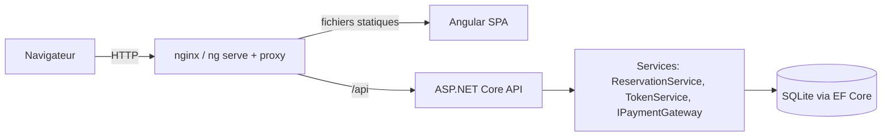
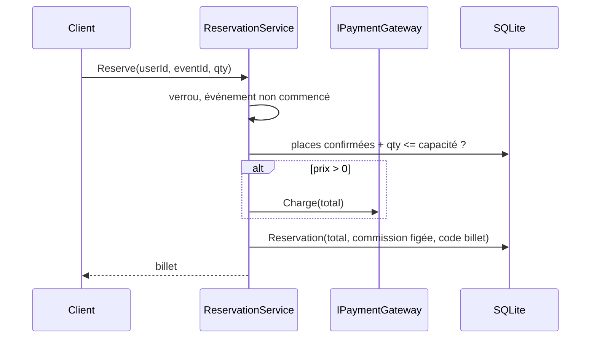

# Architecture

## Vue d'ensemble

Application en deux parties : une SPA Angular et une API REST ASP.NET Core avec base SQLite. En production (Docker), nginx sert la SPA et relaie `/api` vers l'API : une seule origine, donc pas de CORS.

## API (`event-tsika-back/event-tsika-back`)

| Dossier | Rôle |
|---|---|
| `Controllers/` | Endpoints HTTP, validation d'entrée (DataAnnotations), mapping des erreurs vers `ProblemDetails` |
| `Services/` | `ReservationService` (règles de réservation/annulation, commission), `TokenService` (JWT), `PasswordHasher` (PBKDF2), `IPaymentGateway` + implémentation simulée |
| `Data/` | `AppDbContext` (EF Core, SQLite) |
| `Domain/` | Entités `User`, `Event`, `Reservation` et énumérations |
| `Dtos/` | Contrats d'API |
| `Migrations/` | Migrations EF Core, appliquées au démarrage |

### Endpoints

| Méthode et route | Accès | Rôle |
|---|---|---|
| `POST /api/auth/register`, `/login` | public | Compte et jeton |
| `GET /api/events` (`q`, `category`, `city`, `skip`, `take`) | public | Événements à venir |
| `GET /api/events/{id}` | public | Détail |
| `POST/PUT/DELETE /api/events[/{id}]` | Organisateur propriétaire | Gestion |
| `POST /api/events/{id}/reservations` | connecté | Réserver (1-10 places) |
| `GET /api/reservations/mine`, `POST /api/reservations/{id}/cancel` | connecté | Billets |
| `GET /api/organizer/events`, `/{id}/stats`, `/{id}/participants` | Organisateur propriétaire | Tableau de bord |

### Flux de réservation

## Front (`event-tsika`)

- `core/` : `ApiService` (appels HTTP), `AuthService` (session en signal, persistée dans `localStorage`), `auth.http.ts` (intercepteur Bearer + guards), `models.ts`.
- `pages/` : une page par composant standalone, chargée paresseusement par `app.routes.ts`.
- Rendu côté client uniquement (ADR-006).

## Dépendances clés

ASP.NET Core 10, EF Core 10 + SQLite, JwtBearer ; Angular 21, RxJS, vitest, ESLint, Prettier ; nginx pour la production.
